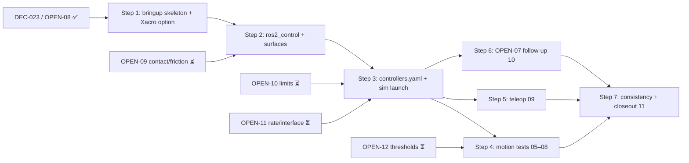

# M2 — Basic Movement: Milestone Plan and Record


**Status:** ✅ **Complete (2026-11-03, closed).** TEST-M2-01 to -11 PASS (several on re-test; every failure kept with its TS entry). DEC-023 to DEC-029 Accepted; OPEN-07 finalized unchanged (DEC-019). Limitations: see §11 (2026-11-03 closure).

## 1. Purpose
Make the M1 robot move in Gazebo Harmonic under `ros2_control`. A differential-drive controller turns velocity commands into wheel commands. Wheel joint states and an initial wheel-odometry estimate are published, and the robot can be driven manually. M3 (sensors) and M4 (quantitative odometry) build on this.

**Background: what `ros2_control` adds.**
- `ros2_control` separates *controllers* (algorithms such as a differential-drive controller) from *hardware interfaces* (here, a Gazebo plugin that stands in for motor drivers).
- The URDF gains a `<ros2_control>` block that lists which joints can be commanded (here: wheel velocity) and which states are read back (position, velocity).
- A `controller_manager` loads the controllers and runs them at a fixed update rate. In simulation it runs inside the Gazebo process, through the `gz_ros2_control` system plugin.
- The same controllers can later drive real hardware by swapping the hardware interface (M13).

## 2. Scope
Derived from `ROADMAP.md` § M2; `docs/architecture/ros_architecture.md` §3; `docs/design/frames_and_tf.md` §5; DEC-013, DEC-017 and DEC-019; `docs/design/mass_inertia.md` §9, OPEN-08 and OPEN-09. Finalized as the working scope on 2026-10-22.

**In scope:**
| Item | Authoritative source |
|---|---|
| Differential-drive control through `ros2_control`: `gz_ros2_control`, `diff_drive_controller` | ROADMAP M2; ros_architecture.md §3 |
| `joint_state_broadcaster` and wheel `/joint_states` in simulation | frames_and_tf.md §4 and §5; ros_architecture.md §3 |
| `odom → base_footprint` published by the drive controller (introduced in M2; direction and basic-consistency checks only) | frames_and_tf.md §5 ("M2 (introduced), M4 (validated)") |
| Velocity command interface (`cmd_vel`) and manual (keyboard) control | ROADMAP M2; ros_architecture.md §3 (teleop) |
| Forward, reverse, rotation, stop; motion verification | ROADMAP M2 |
| `/clock` bridge from Gazebo to ROS | ros_architecture.md §3 |
| Wheel and caster contact and friction parameters | DEC-013 ("deferred to M2"); mechanical_geometry.md §6; OPEN-09 |
| Velocity and acceleration limits, checked against the traction and tipping analysis | mass_inertia.md §9 ("actual limits will be set in M2") |
| Package-structure decision | DEC-017 consequences; OPEN-08 → DEC-023 |
| OPEN-07 follow-up: re-evaluate the provisional rest-stability thresholds | DEC-019; ROADMAP M2 |

**Out of scope (later milestones):**
- Wheel encoders, IMU and LiDAR sensors (M3). The `diff_drive_controller` reads wheel *joint states* from the simulator; that is not an encoder sensor model.
- **Odometry accuracy** (error budgets, drift rates, accuracy acceptance) and the odometry verification test: **M4**. M2 checks only signs, frame identities, and a gross-fault ratio (motion_control.md §6).
- SLAM, localization, Nav2, and the Nav2 footprint (M5–M7).
- Obstacle avoidance and the factory world (M8, M9).
- Payload representation (DEC-015) and the caster mounting arm.
- The dimensioned SVG drawing. It is not an M2 deliverable and has no milestone; assigning one needs a my decision.
- SPDX licence headers (DEC-020 follow-up; deferred by me).
- Physical hardware (M13).

## 3. Design baseline
- Robot model and numeric parameters: `amr_ws/src/amr_description/urdf/amr_properties.xacro` (owner); rationale in [../design/mechanical_geometry.md](../design/mechanical_geometry.md) and [../design/mass_inertia.md](../design/mass_inertia.md).
- **M2 motion design (OPEN-09 to -12 analysis, CALC-M2-01 to -04): [../design/motion_control.md](../design/motion_control.md).**
- Frames: [../design/frames_and_tf.md](../design/frames_and_tf.md) (DEC-016). The wheel joints use axis (0 1 0), with positive = forward on both wheels (OPEN-04; verified by TEST-M1-04).
- Architecture and milestone boundaries: [../architecture/ros_architecture.md](../architecture/ros_architecture.md); package structure DEC-023.
- Requirements and traceability: [../requirements.md](../requirements.md) § M2. Test procedures: [../testing/test_plan.md](../testing/test_plan.md) §6.
- Decisions: DEC-011 to DEC-017, DEC-019, DEC-023 in [../../DECISIONS.md](../../DECISIONS.md).
- Installed versions: [../environment.md](../environment.md) (`ros2_control` 4.48.1; `ros2_controllers`, `diff_drive_controller` and `joint_state_broadcaster` 4.42.1; `gz_ros2_control` 1.2.20; `teleop_twist_keyboard` 2.4.1; `ros_gz_bridge` 1.0.24).
- Installed-software facts used by M2 (controller parameters and defaults, `TwistStamped` input, stale-stamp rejection, DART friction support, measured friction combination rule, teleop behaviour, spawner options) are recorded with their source in motion_control.md §2 and §5.

## 4. Design items

| ID | Item | Status | Proposal / resolution | Needed by |
|---|---|---|---|---|
| OPEN-08 | Package structure; `ros2_control` location; M1 reproducibility | **Resolved: DEC-023 (Accepted 2026-10-22)** | `amr_description` + conditional `use_ros2_control` Xacro option (default off, byte-identical M1 expansion, validated); new `amr_bringup` for controller config and launch | Step 1 |
| OPEN-09 | Wheel and caster contact and friction | **Resolved: DEC-024** | motion_control.md §3. Proposed: wheel μ = 1.0, caster μ = 0.01, no slip/contact-stiffness/torsional parameters (not consumed by DART). Based on the measured min-rule combination and CALC-M2-01/02 | Step 2 |
| OPEN-10 | Velocity and acceleration limits | **Resolved: DEC-025** (indoor low-speed assumption confirmed) | motion_control.md §4. Proposed: v 0.5 / −0.25 m/s; a 0.5, d 1.0 m/s²; ω 1.0 rad/s; α 2.0 rad/s²; no jerk limits; margin ≥ 3× to traction at a design μ of 0.5 and to tipping (CALC-M2-03) | Step 3 |
| OPEN-11 | Controller rate and command interface | **Resolved: DEC-026** | motion_control.md §5. Proposed: `update_rate` 100 Hz; `publish_rate` 50 Hz; `cmd_vel_timeout` 0.5 s; `/cmd_vel` `TwistStamped` (spawner remap); `base_frame_id` `base_footprint`; teleop `stamped:=true`, `use_sim_time:=true` | Step 3 |
| OPEN-12 | Motion-test criteria | **Resolved: DEC-027** | motion_control.md §6. Ground truth vs odometry separated; 3 runs; ±5 % distance/angle, ≤ 20 mm lateral and in-place translation, ≤ 1° heading, stop and timeout windows, < 1° attitude, gross odometry ratio 0.5–1.5 (accuracy is M4) | Step 4 (formal tests) |
| OPEN-07 (from M1) | Rest-stability thresholds | **Finalized unchanged** (decided 2026-11-03 after TEST-M2-10 PASS, DEC-019); provisional at the 2026-10-22 review | Re-measured by TEST-M2-10 on the M2 configuration; proposed evaluation rule in motion_control.md §7; I decide | Step 6 |

## 5. Entry criteria and dependencies

| Criterion | Status |
|---|---|
| M1 complete (TEST-M1-01 to -08 PASS) | ✅ Met (2026-10-21) |
| Required packages installed (versions in environment.md) | ✅ Installed. **Not integrated:** installed packages are not evidence of working functionality |
| Scope accepted as the working plan | ✅ 2026-10-22 |
| OPEN-08 decided (blocks step 1) | ✅ DEC-023 |
| OPEN-09 decided (blocks step 2) | ✅ DEC-024 |
| OPEN-10 and OPEN-11 decided (block step 3) | ✅ DEC-025, DEC-026 |
| OPEN-12 decided (blocks formal motion tests, step 4) | ✅ DEC-027 |

## 6. Architecture and interfaces (package structure per DEC-023; values per OPEN-09 to -11 once decided)

**Runtime graph (M2 simulation):**
```
gz sim (empty world) ─ GazeboSimROS2ControlPlugin ─ controller_manager
                                                       ├─ joint_state_broadcaster ─▶ /joint_states ─▶ robot_state_publisher ─▶ /tf (wheels)
                                                       └─ diff_drive_controller ◀── /cmd_vel (TwistStamped) ◀── teleop_twist_keyboard (stamped:=true) or test script
                                                                                ──▶ ~/odom (nav_msgs/Odometry), /tf (odom → base_footprint)
robot_state_publisher ─▶ /robot_description ─▶ ros_gz_sim create (spawn)      ros_gz_bridge: Gazebo /clock ─▶ ROS /clock
```

**Nodes and responsibilities:**
| Node / component | Package | Responsibility |
|---|---|---|
| Gazebo Sim server (`gz sim`, started directly as in M1, TS-009) | Gazebo Harmonic | Physics (DART, 1 kHz) and world |
| `gz_ros2_control::GazeboSimROS2ControlPlugin` | `gz_ros2_control` | Loaded from the model's `<gazebo>` plugin tag when `use_ros2_control:=true`; parameters file from `controllers_file`. Hosts `controller_manager` and the `GazeboSimSystem` hardware interface for the two wheel joints |
| `joint_state_broadcaster` | `joint_state_broadcaster` | Publishes `/joint_states` for both wheel joints (position, velocity) |
| `diff_drive_controller` | `diff_drive_controller` | `/cmd_vel` → wheel velocity commands, with limits (OPEN-10); wheel states → odometry and `odom → base_footprint` |
| `robot_state_publisher` | `robot_state_publisher` | `/robot_description` (expanded with `use_ros2_control:=true`); wheel TF from `/joint_states` (in Gazebo, new in M2); fixed TF |
| Controller spawner | `controller_manager` (`spawner`) | Loads and activates the two controllers |
| `cmd_vel_guard` | `amr_bringup` (C++, DEC-029) | Forwards `/cmd_vel` to `/diff_drive_controller/cmd_vel` only if \|now − stamp\| ≤ `cmd_vel_timeout`; rejects zero, stale and future stamps; clamps stamps to arrival time (TS-015) |
| `parameter_bridge` | `ros_gz_bridge` | `/clock` Gazebo → ROS |
| `ros_gz_sim create` | `ros_gz_sim` | Spawns the model from `/robot_description` |
| `teleop_twist_keyboard` | `teleop_twist_keyboard` | Manual control; `stamped:=true`, `use_sim_time:=true`, remapped to `/cmd_vel` |

Every M2 ROS node that publishes or consumes stamped data runs with `use_sim_time: true` (REQ-M2-05). Commands stamped on another clock are a recorded hazard (motion_control.md §5; TEST-M2-07(c)).

**Topics and frames:**
| Interface | Type | Producer → consumer | Notes |
|---|---|---|---|
| `/cmd_vel` (DEC-026) | `geometry_msgs/msg/TwistStamped` | teleop / test script → `cmd_vel_guard` | Only `linear.x` and `angular.z` are used; stamps in simulation time |
| `/diff_drive_controller/cmd_vel` | `geometry_msgs/msg/TwistStamped` | `cmd_vel_guard` → `diff_drive_controller` (only publisher) | Accepted commands, stamp ≤ arrival time (DEC-029) |
| `/diff_drive_controller/odom` | `nav_msgs/msg/Odometry` | `diff_drive_controller` | `frame_id` `odom`, `child_frame_id` `base_footprint` |
| `/diff_drive_controller/cmd_vel_out` | `geometry_msgs/msg/TwistStamped` | `diff_drive_controller` (`publish_limited_velocity: true`) | The command after limiting; used by TEST-M2-07/08 |
| `/joint_states` | `sensor_msgs/msg/JointState` | `joint_state_broadcaster` → `robot_state_publisher` | `left_wheel_joint`, `right_wheel_joint` |
| `/tf` `odom → base_footprint` | TF | `diff_drive_controller` | New frame `odom` (REP-105); M4 validates its accuracy |
| `/clock` | `rosgraph_msgs/msg/Clock` | `parameter_bridge` | Simulation time |

**`ros2_control` hardware description (DEC-023):** one `<ros2_control type="system">` block with hardware plugin `gz_ros2_control/GazeboSimSystem`. `left_wheel_joint` and `right_wheel_joint` each have a `velocity` command interface and `position` and `velocity` state interfaces. No other joint is listed.

**Controller parameters (fixed by existing decisions; the rest pending OPEN-10/11):**
| Parameter | Value | Source / status |
|---|---|---|
| `left_wheel_names` / `right_wheel_names` | `[left_wheel_joint]` / `[right_wheel_joint]` | frames_and_tf.md §2; Selected names |
| `wheel_separation` | equals `wheel_track` | DEC-011; checked by TEST-M2-11 |
| `wheel_radius` | equals `wheel_radius` | `amr_properties.xacro`; checked by TEST-M2-11 |
| `base_frame_id` | `base_footprint` (overrides the installed default `base_link`) | DEC-016; frames_and_tf.md §5 |
| `odom_frame_id` | `odom` (installed default) | REP-105 |
| `enable_odom_tf` | `true` (installed default) | frames_and_tf.md §5 |
| `open_loop`, `position_feedback` | installed defaults (`false`, `true`): odometry from wheel position feedback | Proposed |
| `publish_limited_velocity` | `true` | Needed by TEST-M2-07/08 (Proposed) |
| Velocity and acceleration limits (installed default: NaN, i.e. **no limit**) | — | OPEN-10 |
| `update_rate`, `publish_rate`, `cmd_vel_timeout` | — | OPEN-11 |
| Wheel radius/separation multipliers | 1.0 (installed default; no calibration in M2) | Proposed |

The controller YAML cannot read Xacro properties, so `wheel_separation` and `wheel_radius` are duplicated by necessity. TEST-M2-11 checks that they are identical to the Xacro properties, which stay the owner.

**Files to be created or changed (DEC-023; none created yet):**
| File | Purpose |
|---|---|
| `amr_description/urdf/amr.urdf.xacro` (change) | Only the two `xacro:arg` lines and the conditional include (DEC-023 rule) |
| `amr_description/urdf/amr.ros2_control.xacro` (new) | `<ros2_control>` system, Gazebo plugin tag, wheel/caster surfaces (OPEN-09) |
| `amr_bringup/package.xml`, `CMakeLists.txt` (new) | New package (Apache-2.0, DEC-020) |
| `amr_bringup/config/controllers.yaml` (new) | `controller_manager`, `joint_state_broadcaster` and `diff_drive_controller` parameters |
| `amr_bringup/launch/sim.launch.py` (new) | Gazebo, spawn, `/clock` bridge, `robot_state_publisher` (sim time, `use_ros2_control:=true`, `controllers_file`), controller spawners |
| Teleop command (documented in `sim.launch.py` and test_plan.md TEST-M2-09) | `ros2 run teleop_twist_keyboard …` with `stamped:=true`, `use_sim_time:=true` and the remap. Not a launch file: teleop reads the terminal's keyboard, and the installed terminal emulator (`gnome-terminal`) forks and returns, so a launch prefix would not work reliably |
| `docs/evidence/M2/TEST-M2-nn_*` | Test logs, procedures and measurement scripts |

The M1 files `display.launch.py` and `gazebo.launch.py` stay unchanged and keep producing the M1 model (TEST-M2-02).

## 7. Implementation sequence, Tasks, and dependencies
Each step follows Inspect → Plan → Implement → Build → Test → Verify → Document → Review diff → Commit. Each Task's acceptance criteria name its TEST-IDs.

| Step | Work | Blocked by | Verification |
|---|---|---|---|
| 1 | Create `amr_bringup` skeleton; add the Xacro arguments and conditional include | — (DEC-023 decided) | TEST-M2-01 (partial), TEST-M1-08 re-run (byte identity) |
| 2 | `amr.ros2_control.xacro`: `ros2_control` system, plugin tag, contact/friction surfaces | Step 1; **OPEN-09** | TEST-M2-01, TEST-M2-02 |
| 3 | `controllers.yaml` and `sim.launch.py` (bridge, spawn, spawners, sim time) | Step 2; **OPEN-10, OPEN-11** | TEST-M2-03, TEST-M2-04 |
| 4 | Scripted motion tests: forward/reverse, rotation, stop and timeout, limits | Step 3; **OPEN-12** | TEST-M2-05 to -08 |
| 5 | Manual keyboard control | Step 3 | TEST-M2-09 (observed by me) |
| 6 | OPEN-07 follow-up: rest stability with the M2 configuration; my decision recorded in DEC-019 | Step 3 (and OPEN-09 applied) | TEST-M2-10 |
| 7 | Consistency review, records, closeout | Steps 1–6 | TEST-M2-11 |

**Dependency graph** (decisions → steps → tests):

*Update 2026-10-22:* every decision in the graph is resolved (DEC-023 to DEC-027), and I started implementation in this order.

## 8. Tests
Procedures, expected results and pass/fail rules are owned by [../testing/test_plan.md](../testing/test_plan.md) §6. The proposed numeric criteria are in [../design/motion_control.md](../design/motion_control.md) §6 (OPEN-12). Requirement text and traceability are owned by [../requirements.md](../requirements.md) § M2. All tests are `PLANNED`, and none is run before its criteria are fixed. Ground-truth measurements (Gazebo world pose) are kept separate from controller outputs (odometry); odometry accuracy is M4.

| Test | Verifies | Method | Evidence (planned) | Task |
|---|---|---|---|---|
| TEST-M2-01 Build | REQ-M2-01 | `colcon build` of `amr_description` and `amr_bringup` | `docs/evidence/M2/TEST-M2-01_build.log` | A |
| TEST-M2-02 Model regression and control description | REQ-M2-02, -03, -14 | Default variant: the TEST-M1-08 procedure (byte comparison, M1 checks). Enabled variant: `check_urdf`, M2 element check (`ros2_control`, plugin, surfaces in URDF and SDF) | `TEST-M2-02_*` | A |
| TEST-M2-03 Controller startup and fault behaviour | REQ-M2-04 | `ros2 control list_controllers` / `list_hardware_interfaces`, log scan, command before activation, deactivation during motion (characterization) | `TEST-M2-03_*` | B |
| TEST-M2-04 Sim time, joint states, TF and odometry frames | REQ-M2-05, -06, -07 | `/clock`, `use_sim_time`, `/joint_states`, odometry frame ids, TF vs odometry identity, `view_frames` | `TEST-M2-04_*` | B |
| TEST-M2-05 Forward and reverse | REQ-M2-09, -10, -11, -14 | Scripted `TwistStamped` profile; ground truth from `/world/<world>/pose/info`; wheel velocities; odometry signs; 3 runs | `TEST-M2-05_*` | C |
| TEST-M2-06 In-place rotation | REQ-M2-09, -10, -11, -14 | As TEST-M2-05 with an `angular.z` profile | `TEST-M2-06_*` | C |
| TEST-M2-07 Stop, timeout, stale stamps | REQ-M2-12 | Zero command; publishing stopped; stale and wall-clock stamps | `TEST-M2-07_*` | C |
| TEST-M2-08 Limit enforcement | REQ-M2-13, -14 | Step commands above the limits; `cmd_vel_out`, measured acceleration, roll/pitch | `TEST-M2-08_*` | C |
| TEST-M2-09 Manual control | REQ-M2-15 | Keyboard teleop (**observed by me**), including the key-hold/timeout behaviour | `TEST-M2-09_*` | C |
| TEST-M2-10 Rest stability, OPEN-07 follow-up | REQ-M2-16 | TEST-M1-07 method with active controllers and zero command; unchanged provisional thresholds; 3 runs | `TEST-M2-10_*` | D |
| TEST-M2-11 Documentation / configuration consistency | REQ-M2-08, -17 | Script: YAML vs Xacro properties, configured values vs `DECISIONS.md`, records, links, evidence index | `TEST-M2-11_*` | E |

**Simulation and safety checks (current stage, simulation only):**
- Explicit velocity and acceleration limits. The installed controller has none by default (motion_control.md §4).
- Command-loss stop (`cmd_vel_timeout`) and stale-stamp rejection (TEST-M2-07), plus the wall-clock-stamp characterization.
- No motion before the controllers are active, and recorded behaviour on controller deactivation (TEST-M2-03).
- Accelerations checked against the traction and tipping analysis (CALC-M2-03), with roll/pitch monitored (TEST-M2-05/06/08).
- No creep at rest with active controllers (TEST-M2-10).
- Tests run isolated (`ROS_DOMAIN_ID`, `GZ_PARTITION`, as in M1) and check for leftover Gazebo processes (TS-006, TS-009).
- No hardware; physical safety (e-stop, current limits) belongs to M13.

**Documentation and evidence:**
- Each executed test gets a `TEST_RESULTS.md` record in the §3 format of the test plan, with evidence under `docs/evidence/M2/` indexed in `docs/evidence/README.md`. Logs with home paths or hostnames are sanitized, with checksums, as in M1.
- Procedures are scripted (`TEST-M2-nn_procedure.sh` or a measurement script) wherever the test is not a GUI observation.
- Every selected value (OPEN-09 to -12) is recorded in `DECISIONS.md` with its rationale and label. Once implementation exists, configuration files own their values and motion_control.md references them by name.
- **Regression (corrected 2026-10-22 by the DEC-023 validation):** with `use_ros2_control` off (the default), the expanded URDF is byte-identical to the M1 evidence, so **TEST-M1-08 is expected to keep passing unchanged** throughout M2 and is re-run after steps 1, 2 and 7. *(The 2026-10-22 draft expected the byte comparison to break; the conditional design avoids that.)*

## 9. Blockers, pending decisions and risks
**Blocking implementation:** none since 2026-10-22 (DEC-023 to DEC-027). *History: OPEN-09 to OPEN-12 blocked steps 2–4 until I decided them on 2026-10-22.*

**Not blocking M2:**
- SPDX header decision (DEC-020 follow-up; deferred by me). The 2026-10-22 review found no licence headers in any source file. Adding headers to Xacro files changes the generated URDF, and evidence scripts must stay byte-for-byte. Options: (a) no per-file headers; (b) headers only in new files; (c) headers in all non-evidence sources. Under DEC-023, a header in `amr.urdf.xacro` would also break the M1 byte comparison.

**Risks:**
- *`TwistStamped` input:* tools that publish plain `Twist` will not drive the controller. Mitigation: `stamped:=true` on teleop; Nav2's stamped output is checked in M7.
- *Command stamps on the wrong clock* could defeat the timeout (motion_control.md §5). Mitigation: mandatory `use_sim_time`; characterized by TEST-M2-07(c).
- *Caster drag or pivoting:* with the default μ = 1, the caster drag is 23.4 N (CALC-M2-01). Mitigation: OPEN-09; rotation-translation bound in TEST-M2-06.
- *Cylinder–plane contact chatter in DART.* Mitigation: attitude and jitter checks; any geometry change needs a recorded decision.
- *Real-time factor below 1* makes timing checks noisy. Mitigation: simulation-time evaluation; RTF logged; runs with RTF < 0.5 invalid.
- *Teleop key auto-repeat vs the 0.5 s timeout* may cause stop/start while a key is held. Mitigation: recorded in TEST-M2-09; the timeout is revisited only with evidence.

## 10. Exit criteria
M2 is complete only when:
- TEST-M2-01 to TEST-M2-11 are PASS, with evidence in `TEST_RESULTS.md` and `docs/evidence/M2/`. Failures are kept with TS entries and re-tests.
- TEST-M1-08 still passes on the default model expansion (M1 baseline preserved, DEC-023).
- OPEN-09 to OPEN-12 are resolved and recorded in `DECISIONS.md` (including the contact/friction parameters), or stay provisional only with a named follow-up milestone recorded in `DECISIONS.md` (same rule as M1 §7). OPEN-08 is resolved (DEC-023).
- The OPEN-07 follow-up has been performed (TEST-M2-10), and my decision is recorded in DEC-019: confirm, revise, or keep provisional with a new named follow-up milestone.
- Controller configuration, Xacro properties and design documents agree (TEST-M2-11).
- `ROADMAP.md`, the requirements traceability and this record are updated; Tasks A–E are done.

## 11. Implementation record
*(Record each step's outcome, deviations, issues (TS-IDs) and lessons here.)*

- 2026-10-22: plan drafted (Proposed).
- 2026-10-22: scope finalized as the working plan. Planning work completed:
  - OPEN-08 resolved by DEC-023 after validation ([OPEN-08 check log](../evidence/M2/OPEN-08_xacro_option_check.log): default expansion byte-identical to the M1 evidence; enabled expansion valid).
  - OPEN-09 friction-combination probe measured the min rule ([log](../evidence/M2/OPEN-09_friction_probe.log)).
  - OPEN-09 to -12 proposals and CALC-M2-01 to -04 written (motion_control.md).
  - OPEN-07 reviewed: unchanged, still provisional.
  - No implementation started.
- 2026-10-22: my decisions OPEN-09 to -12 → DEC-024 to DEC-027 (`1af0a4d`).
- 2026-10-22: steps 1–3 implemented (`26a6048`): conditional `ros2_control` model, `amr_bringup` (`controllers.yaml`, `sim.launch.py`), harness and procedures. Preliminary runs found and fixed TS-011 to TS-013 before any formal test.
- 2026-10-22: formal suite 1 on `26a6048` (`80b3b2b`):
  - PASS: TEST-M2-01, -03, -05, -07.
  - FAIL: TEST-M2-02 (TS-016), -04 (TS-017/018), -06 and -08 (TS-014: about 196.5° for 180°).
  - Wall-clock HAZARD (TS-015). TEST-M2-10 BLOCKED (visual).
- 2026-10-22: self-directed fixes (`7b90453`): DEC-028 sphere wheel collision (M2 simulation model only), DEC-029 `cmd_vel_guard`, TS-018 YAML entry. Re-test 1 on `7b90453`:
  - TEST-M2-01, -03, -04, -05, -06, -07 (including wall-clock and domain switch), -08 PASS.
  - TEST-M2-02 FAIL (TS-019), then re-test 2 PASS (`96b226b`).
  - TEST-M2-10 quantitative PASS, visual pending (BLOCKED).
- 2026-11-03: GUI session:
  - TEST-M2-09 PASS (observed by me: forward, reverse, rotate both ways, stop). Key-release timing was not observed; the timeout is covered headless by TEST-M2-07.
  - TEST-M2-10 PASS (no visible jitter, observed by me; quantitative 3/3 from re-test 1).
  - I finalized OPEN-07 unchanged (DEC-019).
- 2026-11-03: TEST-M2-11 re-test 2 PASS (111 checks) on the final records.
- **2026-11-03: M2 closed.** Exit criteria (§10):
  - TEST-M2-01 to -11 PASS with evidence: ✅ (TEST-M2-02, -04, -06, -08 and -11 on re-test; TEST-M2-09/10 observed by me on 2026-11-03; every failure is kept).
  - TEST-M1-08 on the default expansion: ✅ (TEST-M2-02 re-test 2; `amr_ws/src` unchanged since).
  - OPEN-08 to -12 decided: ✅ (DEC-023 to DEC-027).
  - OPEN-07 follow-up and my decision: ✅ (TEST-M2-10 PASS; finalized unchanged, DEC-019).
  - Configuration and documents consistent: ✅ (TEST-M2-11 re-test 2).
  - Roadmap and traceability updated: ✅ (in the closeout commit).
- Limitations on record:
  - TEST-M2-09: the key-release behaviour was not observed by me. The 0.5 s command timeout is verified headless by TEST-M2-07 (re-test 1, timeout mode).
  - TEST-M2-11 re-test 2 passed 111 checks, but its checker reads only the first result row per test. The TEST-M2-09 and TEST-M2-10 rows were verified by hand.
  - Carried forward: OPEN-03 (LiDAR bracket) is provisional until M3; the TS-014 contact explanation is a hypothesis; DEC-029 states residual limits of the freshness guard.
